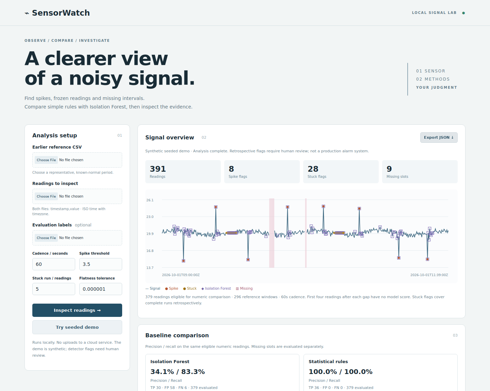

# SensorWatch

**A clearer view of a noisy signal.** A local tool for developers and students investigating single-sensor CSV logs. Flag spikes, stuck readings and missing intervals, compare statistical rules with Isolation Forest, and inspect/export the evidence. This is retrospective analysis for human review, not a production alarm or a physical-control system.

## Run it

Python 3.11+ (tested with 3.12), CPU only. No API key, external model download or paid infrastructure.

```sh
git clone --branch feat/sensorwatch-mvp https://github.com/oshada28nilendra-debug/sensorwatch.git
cd sensorwatch
python -m venv .venv
source .venv/bin/activate  # Windows PowerShell: .venv\Scripts\Activate.ps1
python -m pip install -r requirements-lock.txt
python -m pip install -e . --no-deps
sensorwatch serve
```

Open **http://127.0.0.1:8767** and click **Try seeded demo**. The browser displays the signal, rule/model flags, labelled precision/recall, and a filterable evidence table. Export downloads all timeline rows, scores, settings, hashes, warnings and evaluation metadata. Browser tables display at most 500 matching rows; exports retain every row. A new run clears the old result; export before leaving.



## Inputs and workflow

Provide **two separate CSV files for one sensor**: a representative known-normal earlier reference period, and a later period to inspect. The reference must end before the analysis starts. Labels are optional and used only after scoring. Neither method trains on the analysis period or its labels.

Exact UTF-8 header (BOM accepted):

```csv
timestamp,value
2026-10-01T00:00:00Z,20.12
2026-10-01T00:01:00Z,20.08
2026-10-01T00:02:00Z,
```

- ISO 8601 timestamps must include a timezone. They are normalized to UTC, strictly increasing and unique. Unsorted/duplicate timestamps are rejected, not silently reordered.
- Set the **expected sampling cadence**, e.g. 60 seconds. All timestamps must align to that grid within 1e-6 of an interval. This MVP rejects irregular/jittered timestamps. It does not infer cadence.
- Empty values are missing; absent interior grid slots are expanded as missing. Gaps are never interpolated and break model windows/stuck runs. Only the first-to-last observed span is assessed; outages outside that span cannot be inferred.
- Values must be finite, with absolute magnitude ≤ 1e12. Text/NaN/infinity are invalid, not treated as missing.
- Limits: 5 MiB per CSV, 10,000 input rows, 20,000 expanded slots; 5 MiB optional labels; 16 MiB total HTTP request. At least 20 finite contiguous five-reading reference windows are needed (24 rows if gap-free).
- Cadence and tolerances are in the input sensor's units. No unit conversion, multiple sensors or automatic resampling is included.

For evaluation, labels JSON must cover **every expanded analysis slot exactly once** using canonical UTC timestamp keys, including absent slots:

```json
{
  "description": "How the data and ground truth were obtained",
  "labels": {
    "2026-10-01T05:00:00Z": "normal",
    "2026-10-01T05:01:00Z": "spike",
    "2026-10-01T05:02:00Z": "stuck",
    "2026-10-01T05:03:00Z": "missing"
  }
}
```

Allowed labels: `normal`, `spike`, `stuck`, `missing`. Labels with missing/extra timestamps or unknown categories are rejected. Without labels, the app shows counts, **not accuracy claims**. Label disagreement with detected missingness is permitted and contributes false positives/negatives.

## CLI

```sh
sensorwatch analyze --reference sensorwatch/sample/reference.csv \
  --input sensorwatch/sample/readings.csv \
  --labels sensorwatch/sample/labels.json \
  --cadence 60 --z-threshold 3.5 --stuck-count 5 --epsilon 0.000001 \
  --output reports/my-evaluation.json
```

Omit `--labels` for ordinary inspection. CLI validation failures exit with code 2 and an actionable error. Inputs are never modified. To regenerate bundled fixtures deterministically: `python -m sensorwatch.sample_data`.

## How detection works

**Statistical rules.** Reference median and `1.4826 × MAD` define a robust scale. A reading is a spike candidate when its absolute deviation / scale exceeds 3.5. If MAD is zero, standard deviation is used; a constant reference uses `max(abs(median) × 1e-6, 1e-6)`. The chosen fallback appears in exports. This is a reference-distribution outlier rule, not proof of a physical spike or a change-point detector.

A stuck candidate is any reading in a contiguous run of at least five finite values whose **full max−min range** is at most epsilon (default 1e-6). Overlapping qualifying windows are included. This retrospective rule marks the beginning of a run after sufficient later evidence; it is not an online detection-delay claim. Legitimately stable or coarsely quantized signals can produce false positives.

**Isolation Forest.** Scikit-learn, 100 trees, seed 42, one worker, contamination 0.05. Fit only on earlier reference features: current value, absolute previous-value delta, and trailing five-reading population standard deviation. This is an unsupervised fitted model, not pretrained weights. Five finite consecutive readings are required. Score is negative `decision_function`; **score > 0** flags an anomaly, not a calibrated probability. Contamination sets a reference-score threshold; it is not a known test fault percentage. No hyperparameters were tuned using test labels.

**Evaluation.** Both numeric methods are compared on the same model-eligible readings. Ground-truth positives are `spike` or `stuck`; other labels are negative for this numeric comparison. The rule detector can flag additional warmup readings in the UI, but those are excluded from both numeric metric denominators; excluded labelled faults are reported. TP/FP/FN/TN, precision, recall and F1 are point-level, with **no event-level adjustment**. Undefined precision/recall/F1 is JSON `null`, not an invented zero or perfect score. Missing-slot detection is evaluated separately over the entire supplied span. Model fit and scoring timings exclude parsing/UI and are single-run CPU observations.

## Actual synthetic evaluation — 2026-10-12

[Full measured report](reports/synthetic-evaluation.json), generated with seed **20261012**. 300 earlier reference readings; 400 later expected slots; 8 injected spikes, two 14-reading flat runs, 7 deleted timestamps and 2 blank values. 379 numeric readings are eligible. The data is authored and synthetic, not collected from users or real equipment. Faults are deliberately easy for the rule assumptions; perfect demo results do not establish real-world accuracy.

| Detector / scope | TP | FP | FN | Precision | Recall |
|---|---:|---:|---:|---:|---:|
| Rules / eligible numeric readings | 36 | 0 | 0 | 100% | 100% |
| Isolation Forest / same readings | 30 | 58 | 6 | 34.09% | 83.33% |
| Missing slots / all 400 slots | 9 | 0 | 0 | 100% | 100% |

The model catches all eight spikes and 22/28 stuck readings, but flags 58 normal readings. A trailing feature window can remain unusual after a spike has ended; reference variation and threshold choice also matter. The rule baseline wins on this fixture. The missing-slot result checks reconstruction of intentionally deleted/blank grid entries; it is not evidence that real-world communication failures can be diagnosed. No event cause, production fitness or adoption is claimed.

## Architecture, limitations and next steps

`core.py` handles validated CSVs, grid expansion, features, detectors and metrics. `sample_data.py` creates labelled seeded fixtures. The CLI and stateless Flask API share the core. Vanilla JS renders the signal and evidence using text nodes/SVG, without executing imported markup. Web inputs stay in memory; only explicit exports/CLI outputs are persisted. Local request/host guards, bounded uploads, CSP and no-store headers are included. The localhost Flask development server is not a public deployment configuration.

Limits: one numeric channel; exact regular cadence; English UI; stationary reference assumption; no automatic seasonality, drift adaptation, causal diagnosis, alert delivery or equipment actuation. Reference data may itself be faulty: the tool cannot certify it as normal. Long gaps reduce numeric coverage. A sensor holding a legitimate constant value is indistinguishable from a stuck sensor using values alone. The fixture has an earlier/later split, but no independently collected evaluation dataset or confidence intervals. Before operational use, obtain representative independently labelled data, calibrate settings on a separate development split, and test false-alarm rates and detection delay.

## Verification

```sh
python -m pytest -q
npm ci
npx playwright install chromium
# In another terminal: sensorwatch serve
npm run test:browser
```

Tests cover timestamp/timezone validation, invalid/oversized inputs, grid gaps, flat-run boundaries/overlaps, warmup eligibility, constant references, deterministic model scores, exact metric calculations, label coverage, HTTP guards and CLI errors. Browser tests cover demo, chart, filtering, JSON contents, real uploads, unlabelled results, stale-result clearing and mobile overflow. GitHub Actions runs the Python suite, measured CLI demo and actual Chromium checks; inspect the PR for remote status. [Build record](docs/project-status.md).


Reference: [scikit-learn IsolationForest documentation](https://scikit-learn.org/stable/modules/generated/sklearn.ensemble.IsolationForest.html). Installed version is pinned to 1.8.0; reports record the actual version. No third-party datasets are redistributed.
